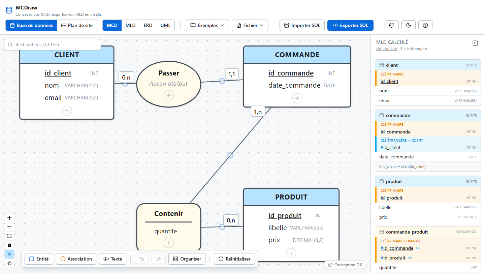
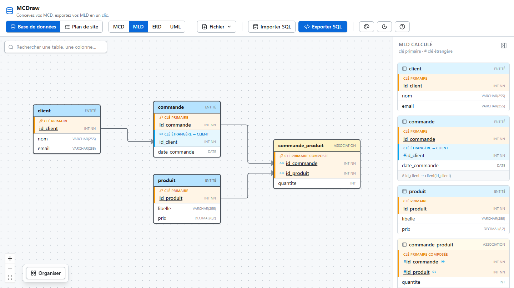
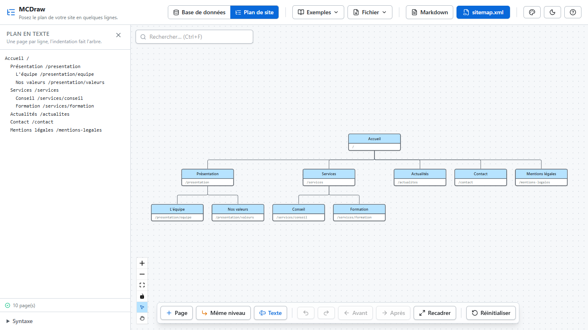

<div align="center">

# MCDraw

**Draw your data model. Get your database.**<br/>
A light, fast, in-browser diagramming tool: Merise conceptual models (MCD) that turn into SQL, ORM code and test data — plus simple brainstorming diagrams such as site maps.

[🇬🇧 English](README.md) · [🇫🇷 Français](README.fr.md)




</div>

## Why MCDraw?

- **Light and fast** — opens instantly, nothing to install, nothing to sign up for. Your work is saved in your browser.
- **Your model is the only input** — normalisation, relational schema, SQL, ORM code and sample data are *derived* from your MCD, live.
- **Share without an account** — the whole diagram lives in the link (`#share=…`); nothing is stored on a server.
- **More than one kind of diagram** — one shared editor (undo/redo, search, export, share, themes), one tab per diagram type.

## Diagram types

| Type | What you get |
| --- | --- |
| **Database** (Merise) | MCD editor with cardinalities, relative identifiers (CIF), inheritance → computed **MLD**, **ERD** (crow's foot) and **UML** class views |
| **Site map** | Type your pages as an indented list *or* draw the tree — both stay in sync. Export a **Markdown** list or a **`sitemap.xml`** (sitemaps.org) |

<table>
  <tr>
    <td></td>
    <td></td>
  </tr>
  <tr>
    <td align="center"><sub>MLD: tables, primary and foreign keys</sub></td>
    <td align="center"><sub>Site map: one page per line, the indentation makes the tree</sub></td>
  </tr>
</table>

## Features

### Database (Merise)

- **Faithful Merise modelling** — entities, associations (with attributes), cardinalities `0,1` `1,1` `0,n` `1,n`, relative identifier (CIF, double border), reflexive and ternary associations, **inheritance** (one table per class / single table / one table per child class).
- **Fast editing** — double-click to edit in place, `Tab`/`Enter` to chain attributes, drag to reorder, multi-selection (rectangle), copy / paste / duplicate, undo / redo with grouped typing, `Ctrl+F` search.
- **Text-to-MCD** — describe the model in a few lines (Mocodo-like syntax), the diagram and its layout are generated.
- **Live validation** — missing primary keys, duplicate names, dangling associations, cyclic `(1,1)—(1,1)` dependencies, SQL Server cascade pitfalls.
- **Derived views** — MLD, ERD (crow's foot) and UML class diagram, all exportable as PNG / SVG / PDF.
- **Code generation** — SQL DDL for **PostgreSQL, MySQL/MariaDB, SQLite, SQL Server**; **C# / EF Core** (`DbContext` + Fluent API); **Prisma**; **TypeORM**; **Mermaid** and **PlantUML** blocks for your README or wiki.
- **Sample data** — realistic `INSERT` scripts (up to 1,000 rows per table, foreign-key-safe order) in SQL, Bogus (C#) or Faker (JS), generated in a Web Worker.
- **Import SQL → MCD** — paste existing `CREATE TABLE` statements and get a model back.
- **Customisable theme** (entities, associations), light and dark mode.

### Site map

- Text ⇄ tree, live and two-way (pages keep their identity while you type, errors are located by line).
- Deterministic tree layout that respects the order of your lines.
- Child page `N`, sibling page `S`, **Before / After** buttons to reorder, in-place renaming, address and note per page, copy / paste of whole subtrees, search.
- Three starter templates.

### Everywhere

- Export / import the project as JSON (importing a file of another type offers to switch to it).
- Share by link, no account and no backend.
- Auto-save in the browser.
- Keyboard shortcuts (press the `?` button in the header).

## From MCD to MLD: the rules applied

| MCD pattern | Resulting tables |
| --- | --- |
| Entity | One table; its identifier becomes the primary key |
| `(x,1)` — `(x,n)` association | **Foreign key** on the side of the `1` cardinality; association attributes move with it |
| `(x,1)` — `(x,1)` association | Foreign key with a **`UNIQUE`** constraint |
| `(x,n)` — `(x,n)` association | **Junction table**: composite primary key made of both identifiers, plus the association's attributes |
| Ternary (or higher) association | Junction table with one foreign key per leg; a leg with maximum cardinality `1` stays a foreign key but is left out of the primary key |
| Reflexive association | Same rules, with the key columns prefixed by the leg's **role** so they stay distinct |
| Relative identifier (CIF) | The parent's key joins the child's **composite primary key** |
| Inheritance | Chosen strategy: one table per class, single table, or one table per child class |

## Getting started

Requires [Node.js](https://nodejs.org/) 22+.

```bash
git clone https://github.com/MarleyAvix/MCDraw.git
cd MCDraw
npm install
npm run dev
```

Then open the URL printed by Vite (usually <http://localhost:5173>).

| Command | Purpose |
| --- | --- |
| `npm run dev` | Development server |
| `npm run build` | Type-check and production build (`dist/`) |
| `npm run preview` | Serve the production build locally |
| `npm test` | Unit and component tests (Vitest) |
| `npm run test:e2e` | End-to-end tests (Playwright) |

### With Docker

```bash
docker build -t mcdraw .
docker run --rm -p 8080:80 mcdraw
```

The app is then served by nginx on <http://localhost:8080>.

## Tech stack

[Vue 3](https://vuejs.org/) · TypeScript · [Pinia](https://pinia.vuejs.org/) · [Vue Flow](https://vueflow.dev/) · Tailwind CSS v4 · Vite · Vitest · Playwright · [lucide](https://lucide.dev/) icons · [`@faker-js/faker`](https://fakerjs.dev/).

## Architecture: adding a new diagram type

A *document type* is described by a single contract, [`DocumentType`](src/core/documentType.ts): its views, panels, actions, shortcuts, examples and exports. The shell (header, undo/redo, auto-save, sharing, export, search) is shared.

```
src/
├─ core/          DocumentType contract, registry, shell state
├─ documents/
│  ├─ mcd/        Database (Merise)
│  └─ sitemap/    Site map
├─ engine/        Pure logic: MCD → MLD, SQL, ORM, seed data, share links…
├─ composables/   History, persistence, canvas tools, file I/O…
└─ components/    Canvas, panels and modals of the database type
```

To add a type (mind map, org chart…): create a folder in `src/documents/`, implement `DocumentType`, and register it in `src/documents/index.ts`. History, auto-save, JSON export, share links and search come for free.

## Contributing

MCDraw is an open-source side project and contributions are welcome — bug reports, ideas, new diagram types, translations. Please run `npm test` and `npm run build` before opening a pull request. Commits follow the [Conventional Commits](https://www.conventionalcommits.org/) style.
